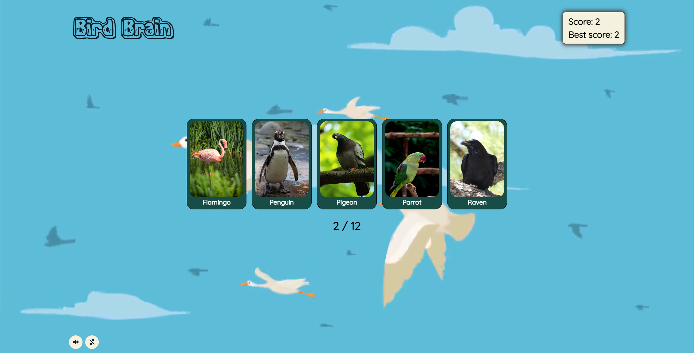

# Bird Brain — Memory Game

An interactive, responsive memory card game built with **React** and bundled via **Vite**. Players test their memory by selecting cards without clicking the same bird twice, featuring adaptive difficulty levels, sound controls, and comprehensive asset preloading.



## Live Demo

Play online: [**odin-memory-card-sadwipe.netlify.app**](https://odin-memory-card-sadwipe.netlify.app/)

## Key Features & Technical Highlights

* **State & Game Loop:** Tracks current score, high score persistence, dynamic card shuffling on each turn, and win/loss resolution conditions.
* **Asset Preloading & Performance:** Implements image preloading prior to gameplay start to prevent layout shifts and asset pop-in during fast shuffles.
* **Audio & Media Management:** Custom volume and mute controls for background music and game sound effects.
* **Component Testing:** Unit and integration testing on core menu and loading states using **React Testing Library** and **Vitest**.
* **Containerization:** Includes a production-ready multi-stage `Dockerfile` serving static assets via Nginx.
* **Difficulty Scaling:** Dynamic card deck sizing based on selected mode (Easy, Medium, Hard).

## Tech Stack

* **Core:** React 18, JavaScript (ES6+)
* **Build Tool:** Vite
* **Testing:** Vitest, React Testing Library
* **DevOps:** Docker
* **Styling:** Modular CSS3, CSS Reset, Responsive Layouts
* **Deployment:** Netlify

## Getting Started

### Local Development

1. Clone repository:
   ```bash
   git clone https://github.com/sadwipe/Memory-Card.git
   cd Memory-Card
   ```

2. Install dependencies:
   ```bash
   npm install
   ```

3. Run development server:
   ```bash
   npm run dev
   ```

4. Run test suite:
   ```bash
   npm test
   ```

### Run with Docker

1. Build Docker image:
   ```bash
   docker build -t bird-brain .
   ```

2. Run container:
   ```bash
   docker run -d -p 8080:80 bird-brain
   ```

3. Access the application at `http://localhost:8080`.
